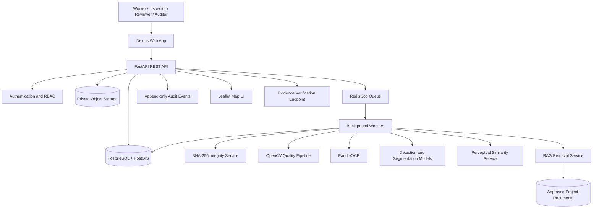

# GroundTruth System Architecture

## 1. Architectural style

Start with a modular monolith plus asynchronous workers. Separate domain modules and adapters. Extract services only when scaling, ownership or reliability justifies it.

## 2. Logical architecture

## 3. Component responsibilities

### Web application
- Authentication screens.
- Project/milestone workspace.
- Capture/upload interface.
- Evidence status and history.
- Reviewer dashboard.
- Annotated evidence viewer.
- Map and reporting screens.
- Verification page.

### API
- Authentication and authorization.
- Project and milestone management.
- Evidence lifecycle orchestration.
- Metadata validation.
- File upload authorization.
- Review decisions.
- Search, reporting and verification.
- Audit event creation.

### Evidence storage
- Private object bucket.
- Immutable original object key.
- Separate derived object keys.
- Versioning and retention controls.
- Signed URL access with short expiry.

### AI workers
- File decoding and quality analysis.
- OCR extraction.
- Duplicate/similarity search.
- Vision inference.
- RAG retrieval and requirement comparison.
- Findings persistence.

## 4. Trust boundaries

- Browser input is untrusted.
- EXIF and device GPS are untrusted claims.
- Uploaded image and OCR text are untrusted content.
- AI outputs are untrusted recommendations until reviewed.
- Object storage and database access are server-only.
- Public verification is a deliberately limited read-only boundary.

## 5. Key architecture decisions

- No blockchain dependency.
- SHA-256 computed by server from exact original bytes.
- Perceptual hashes used for visual similarity, not cryptographic proof.
- PostGIS supports project geofences and spatial queries.
- Original evidence never modified by preprocessing.
- Asynchronous AI pipeline prevents long-running HTTP requests.
- Human decision is authoritative.
- RAG retrieval respects project-level permissions.

## 6. Deployment topology

For MVP, deploy:
- Web frontend.
- API container.
- Worker container.
- PostgreSQL/PostGIS.
- Redis.
- Private object storage.
- Monitoring and centralized logs.

Use separate staging and production environments. Keep secrets and data isolated.
