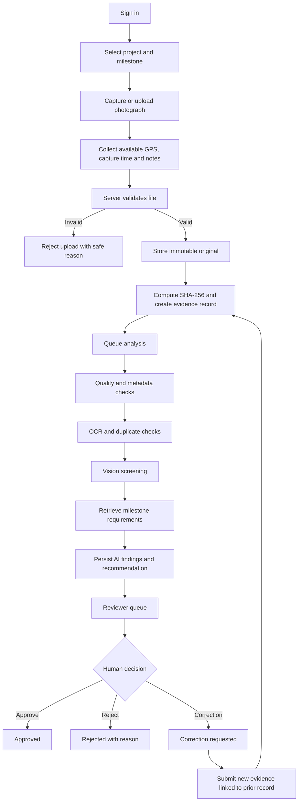

# GroundTruth Workflows

## 1. End-to-end evidence workflow

## 2. Capture workflow

1. Request camera and location permissions with clear explanation.
2. Allow user to proceed when optional location permission is denied, if project policy permits.
3. Capture image in-app where supported; distinguish in-app capture from gallery upload.
4. Record device timestamp, client submission time, available EXIF and GPS separately.
5. Record GPS accuracy and metadata source.
6. Ask user to select evidence category and add optional notes.
7. Show upload progress and final evidence ID.

Do not claim that in-app capture or EXIF guarantees authenticity.

## 3. Upload and integrity workflow

1. Authenticate and authorize project/milestone.
2. Validate size, file signature, MIME, dimensions and decode.
3. Quarantine and scan where configured.
4. Calculate server-side SHA-256.
5. Store original under generated object key.
6. Read back/verify stored bytes where practical.
7. Persist evidence and file metadata.
8. Append `EVIDENCE_SUBMITTED` audit event.
9. Queue analysis.

## 4. AI pipeline workflow

Run independent tasks with explicit statuses:
- `FILE_VALIDATION`
- `QUALITY_ASSESSMENT`
- `OCR`
- `EXACT_DUPLICATE`
- `PERCEPTUAL_SIMILARITY`
- `VISION_INFERENCE`
- `REQUIREMENT_RETRIEVAL`
- `FINDINGS_AGGREGATION`

Each task records input evidence version, pipeline version, model version, start/end time, result and failure reason. A partial failure must not erase successful outputs.

## 5. Human review workflow

Reviewer sees:
- Original image and permitted derivatives.
- Capture and submission metadata with source labels.
- Quality metrics.
- OCR text.
- Similarity candidates.
- Vision findings and annotated regions.
- Applicable requirement citations.
- Previous submissions and corrective actions.

Decision options:
- Approve evidence for the specified milestone.
- Reject with mandatory reason.
- Request correction with explicit instructions.

A reviewer must be able to disagree with AI. Record overrides for later evaluation.

## 6. Corrective action workflow

- Create corrective action linked to the rejected/correction-requested evidence and milestone.
- Record issue, required action, owner and due date.
- Submitter receives notification.
- New evidence is submitted as a new record.
- Reviewer compares old and new records.
- Close corrective action only after authorized decision.
- Preserve all versions and decisions.

## 7. Verification workflow

- Resolve opaque evidence ID or QR token.
- Check whether verifier is authorized for full or public view.
- Recompute SHA-256 when verifying stored original.
- Compare computed hash to recorded hash.
- Return `MATCH`, `MISMATCH` or `UNAVAILABLE`.
- Show review status separately.
- Never state that a hash match proves the scene, GPS or construction quality is genuine.

## 8. Exception workflows

- GPS unavailable: record unavailable and continue if policy permits.
- AI service unavailable: retain evidence and mark analysis pending/failed; allow reviewer workflow according to policy.
- Duplicate suspected: flag for reviewer; do not auto-reject solely on similarity.
- Hash mismatch: quarantine record, alert operations/security, preserve logs.
- Storage unavailable: do not mark upload successful.
- Reviewer conflict: escalate to a second reviewer or supervisor according to organization policy.
